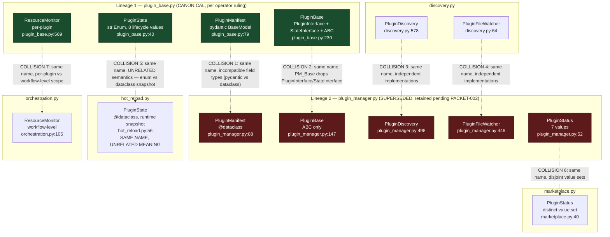
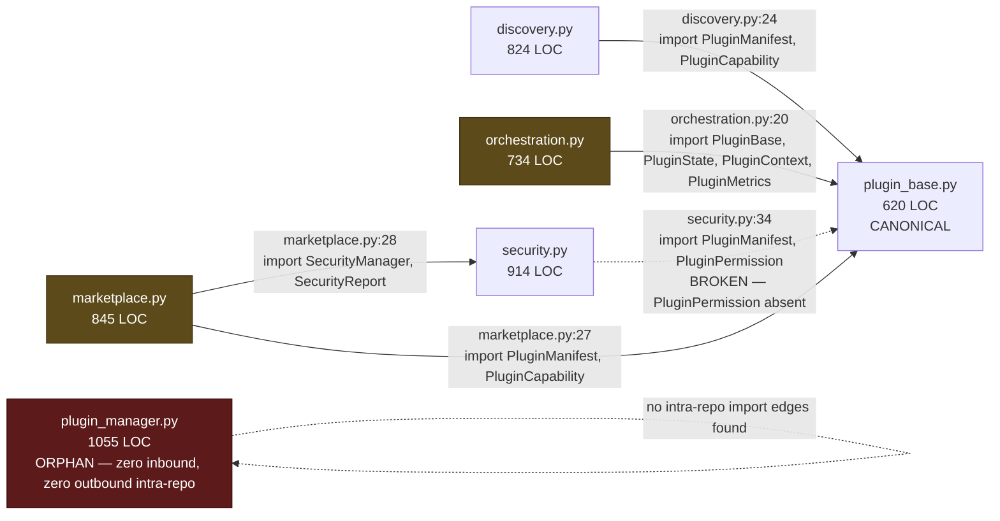
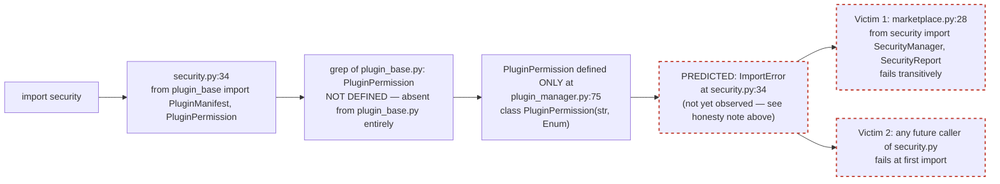
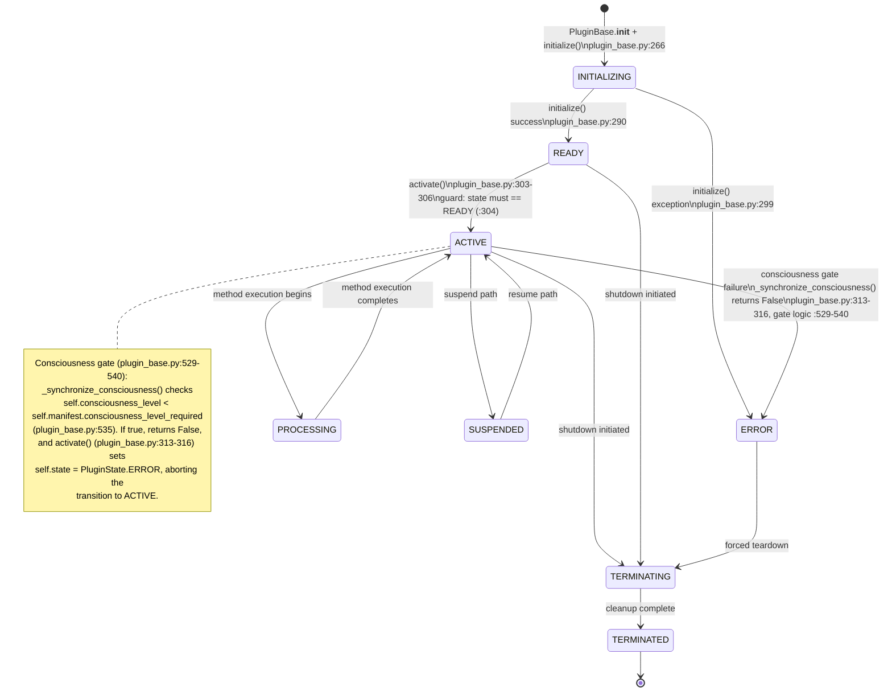
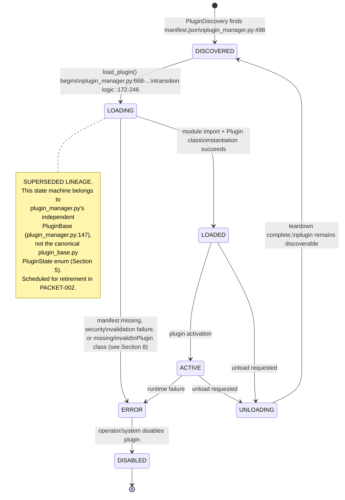
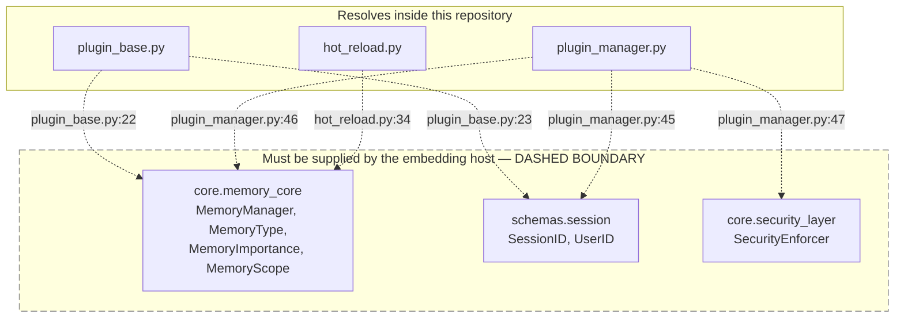

ARCHITECTURE.md
Classification: INTERNAL
Version: 1.0
Date: 2026-09-05
Author/Origin: Claude Code (execution arm), source-read only, no runtime executed
Status: DRAFT

## 0. Scope and Method

This document describes the `somnus-plugin-system` repository as extracted from the private `somnus-os` donor codebase at commit `5278e3c` (2026-09-05). Every structural and behavioral claim below is grounded in a direct source read of the seven top-level modules and is cited as `file:line`. No claim in this document is inferred from naming conventions, docstrings, or comments alone unless explicitly marked as such.

This repository is a plugin substrate intended for embedding inside a larger Somnus host system. It is not a standalone application. References to `core.memory_core`, `schemas.session`, and `core.security_layer` are host-supplied dependencies, not repository defects — see Section 6.

The operator (Daeron) has ruled that `plugin_base.py` is the canonical lineage for plugin typing and lifecycle. `plugin_manager.py` contains a second, independently-typed, and independently-loaded lineage whose unique runtime mechanisms (file watching, hot discovery, threaded execution wiring) are slated for rebasing onto `plugin_base.py` in a future packet (PACKET-002), after which `plugin_manager.py`'s duplicate type definitions are to be deleted. This document describes the state of the repository as of this session — the convergence has NOT happened. No source file was modified to produce this document.

---

## Table of Contents

1. Module Inventory
2. Two-Lineage Class Ownership Map
3. Dependency Graph and Orphan Analysis
4. Import Break Trace (security.py -> plugin_base.py)
5. Canonical Lifecycle State Machine (plugin_base.py)
6. Superseded Lifecycle State Machine (plugin_manager.py)
7. Host Boundary / Trust-Zone Map
8. The Loader Contract
9. Manifest Fields Declared But Never Read
10. installed/example_plugin/ — Committed-Empty Fixture
11. Known Gaps Requiring Operator Input

---

## 1. Module Inventory

| Module | LOC | Role (as read from source) |
|---|---|---|
| `discovery.py` | 824 | Plugin discovery, dependency resolution, compatibility checking, filesystem watch for plugin directories. Owns `PluginDiscovery` (`discovery.py:578`), `PluginFileWatcher` (`discovery.py:64`), `DependencyResolver` (`discovery.py:130`), `PluginScanner` (`discovery.py:420`). |
| `hot_reload.py` | 834 | Runtime hot-reload engine: dependency graph tracking, state preservation across reload, file-change-triggered reload. Owns `HotReloadEngine` (`hot_reload.py:460`), `StateManager` (`hot_reload.py:242`), `PluginState` (`hot_reload.py:56`, a dataclass runtime snapshot — see Section 2 for name collision). |
| `marketplace.py` | 845 | Remote plugin registry client, trust scoring, archive install/update, download verification. Owns `PluginMarketplace` (`marketplace.py:714`), `RegistryClient` (`marketplace.py:191`), `TrustSystem` (`marketplace.py:127`), `PluginInstaller` (`marketplace.py:437`). |
| `orchestration.py` | 734 | Plugin method execution, workflow engine (sequential/parallel/pipeline/graph/reactive), resource monitoring, execution queueing. Owns `PluginOrchestrator` (`orchestration.py:456`), `PluginExecutor` (`orchestration.py:198`), `WorkflowEngine` (`orchestration.py:259`), `ExecutionQueue` (`orchestration.py:151`). |
| `plugin_base.py` | 620 | Canonical (per operator ruling) plugin type system and lifecycle base class. Owns `PluginManifest` (pydantic, `plugin_base.py:79`), `PluginBase` (`plugin_base.py:230`), `PluginState` (str Enum, `plugin_base.py:40`), `ResourceMonitor` (per-plugin, `plugin_base.py:569`). |
| `plugin_manager.py` | 1055 | Second, independent plugin loader and type lineage — file discovery, security-gated load, hot-reload watcher, FastAPI route mounting. Owns `PluginManifest` (dataclass, `plugin_manager.py:88`), `PluginBase` (`plugin_manager.py:147`), `PluginManager` (`plugin_manager.py:567`), `PluginDiscovery` (`plugin_manager.py:498`), `PluginFileWatcher` (`plugin_manager.py:446`), `PluginPermission` (`plugin_manager.py:75`). |
| `security.py` | 914 | Static code analysis sandbox, cryptographic signature validation primitives, dependency risk analysis. Owns `SecurityManager` (`security.py:609`), `CodeAnalyzer` (`security.py:181`), `SandboxEnvironment` (`security.py:70`), `CryptographicValidator` (`security.py:442`). |

Total: 5,826 lines across 7 modules (`wc -l` verified this session).

---

## 2. Two-Lineage Class Ownership Map

Seven class names are defined more than once across the repository, each pair representing an independent, non-interoperable type. This is the central structural fact of the current repository state.



**Legend.** Green = canonical lineage per operator ruling. Red = superseded lineage, retained only because PACKET-002 has not yet run. Dashed cross-links marked "COLLISION" are the seven same-name, different-type definitions. Collision 5 (`PluginState`) is the most severe: an enum member (`plugin_base.py:40`, e.g. `PluginState.ACTIVE`) and a dataclass instance (`hot_reload.py:56`) are interchangeable by name in an import statement but carry zero structural overlap — any code that imports the wrong one under the assumption of the other's shape will fail at attribute-access time, not at import time.

### 2.1 Verified field/definition detail for each collision

| # | Name | Definition A | Definition B | Nature of collision |
|---|---|---|---|---|
| 1 | `PluginManifest` | `plugin_base.py:79` — `class PluginManifest(BaseModel)`, 33 pydantic fields including `capabilities: List[PluginCapability]`, `security_level: int`, `plugin_type: str` | `plugin_manager.py:88` — `@dataclass class PluginManifest`, narrower field set, no `capabilities`, no `security_level`, `plugin_type: PluginType` (enum), `permissions: List[PluginPermission]` (enum) | Same name, incompatible construction (`PluginManifest(**data)` succeeds or fails differently depending on which is in scope), incompatible field typing — see Section 9 for the full schema drift table. |
| 2 | `PluginBase` | `plugin_base.py:230` — `class PluginBase(PluginInterface, StateInterface, ABC)` | `plugin_manager.py:147` — `class PluginBase(ABC)`, no interface mixins | Same name, `plugin_manager.py`'s version has no `metrics` attribute contract (see D-012 in DEFECT_INDEX.md) and no consciousness-gate machinery. |
| 3 | `PluginDiscovery` | `discovery.py:578` | `plugin_manager.py:498` | Same name, independently implemented discovery logic; `plugin_manager.py`'s copy is used by `PluginManager` (`plugin_manager.py:567`) and never touches `discovery.py`. |
| 4 | `PluginFileWatcher` | `discovery.py:64` — `class PluginFileWatcher(FileSystemEventHandler)` | `plugin_manager.py:446` — `class PluginFileWatcher(FileSystemEventHandler)` | Same base class, same name, independently implemented — not the same object at runtime under any import path. |
| 5 | `PluginState` | `plugin_base.py:40` — `class PluginState(str, Enum)`, 8 lifecycle values (see Section 5) | `hot_reload.py:56` — `class PluginState` (dataclass, runtime snapshot fields, unrelated to lifecycle enum) | Same name, unrelated meaning. Highest-risk collision in the repository. |
| 6 | `PluginStatus` | `plugin_manager.py:52` — `class PluginStatus(str, Enum)`, 7 values (DISCOVERED, LOADING, LOADED, ACTIVE, ERROR, DISABLED, UNLOADING) | `marketplace.py:40` — `class PluginStatus(str, Enum)`, distinct value set describing marketplace listing status, not runtime lifecycle | Same name, disjoint value sets, disjoint domains (runtime state vs. marketplace listing state). |
| 7 | `ResourceMonitor` | `plugin_base.py:569` — per-plugin resource tracking, instantiated per `PluginBase` instance | `orchestration.py:105` — `class ResourceMonitor`, workflow/orchestrator-level, instantiated once by `PluginOrchestrator.__init__` (`orchestration.py:461`) | Same name, different scope of measurement (single plugin vs. whole orchestrator). |

---

## 3. Dependency Graph and Orphan Analysis



**Verified edges** (grep of all `import` / `from` statements, this session):

- `discovery.py:24` -> `from plugin_base import PluginManifest, PluginCapability`
- `orchestration.py:20` -> `from plugin_base import PluginBase, PluginState, PluginContext, PluginMetrics`
- `security.py:34` -> `from plugin_base import PluginManifest, PluginPermission` — **BROKEN**, see Section 4
- `marketplace.py:27` -> `from plugin_base import PluginManifest, PluginCapability`
- `marketplace.py:28` -> `from security import SecurityManager, SecurityReport`

**Orphan: `plugin_manager.py`.** A full grep of `import`/`from` statements across all seven modules shows `plugin_manager.py` has zero outbound imports of any other repository module, and zero other module imports anything from `plugin_manager.py`. It is self-contained and unreferenced. Despite being the largest module (1055 LOC) and containing the only fully-wired FastAPI mount path (`plugin_manager.py:1035-1036`), nothing in this repository currently invokes it.

**Unreferenced islands.** `orchestration.py` and `marketplace.py` are imported by nothing else in the repository (no module does `from orchestration import ...` or `from marketplace import ...`). Both take an untyped, duck-typed `plugin_manager` constructor parameter with no type annotation and no import of any `PluginManager` class:

- `orchestration.py:457` — `def __init__(self, plugin_manager):` (inside `PluginOrchestrator.__init__`, no type hint, no corresponding import)
- `marketplace.py:715` — `def __init__(self, plugin_manager, security_manager: SecurityManager, ...)` (inside `PluginMarketplace.__init__`; `plugin_manager` untyped, `security_manager` typed via the one real inter-module edge)

This means `PluginOrchestrator` and `PluginMarketplace` are written to be handed *some* plugin-manager-shaped object by their caller, but the caller and the object's contract are not present or determinable from this repository alone.

---

## 4. Import Break Trace: `security.py` -> `plugin_base.py`

**CRITICAL HONESTY REQUIREMENT — read before acting on this section.** The failure below is **grep-verified absent, ImportError PREDICTED, NOT YET OBSERVED.** No Python interpreter has been invoked this session; no dependency install (`pip install` of `pydantic`, `fastapi`, `cryptography`, `aiofiles`, etc.) has run against this checkout. The prerequisite for actually observing this ImportError is a working virtual environment with the repository's undeclared dependencies installed and an attempt to `import security` or `import marketplace`. That prerequisite has not been executed. The trace below is a static analysis of import statements and class definitions, confirmed by direct grep of both files this session — it is not a runtime observation.



**Origin point.** `security.py:34` reads:
```python
from plugin_base import PluginManifest, PluginPermission
```
`PluginManifest` resolves — it is defined at `plugin_base.py:79`. `PluginPermission` does not resolve against `plugin_base.py`: a grep of `plugin_base.py` for `class PluginPermission` and for the bare token `PluginPermission` returns no definition. The only definition of `PluginPermission` repository-wide is `plugin_manager.py:75` — `class PluginPermission(str, Enum)`, a member of the superseded lineage that `security.py` does not import from.

**Consumption sites inside `security.py` that depend on the missing symbol** (grep-verified, this session):
- `security.py:220` — `PluginPermission.NETWORK_ACCESS: [...]`
- `security.py:223` — `PluginPermission.FILE_SYSTEM: [...]`
- `security.py:226` — `PluginPermission.SYSTEM_COMMANDS: [...]`
- `security.py:229` — `PluginPermission.AGENT_CONTROL: [...]`
- `security.py:419` — `def check_permissions(self, content: str, required_permissions: List[PluginPermission])`
- `security.py:433` — `for permission in PluginPermission:`
- `security.py:703-705` — `PluginPermission.SYSTEM_COMMANDS`, `PluginPermission.FILE_SYSTEM`, `PluginPermission.AGENT_CONTROL`

**Downstream victim.** `marketplace.py:28` — `from security import SecurityManager, SecurityReport` — imports the module whose own import statement is predicted to fail first. One point of origin (`security.py:34`), two downstream effects: `security.py` itself becomes unimportable, and `marketplace.py` becomes transitively unimportable through it.

**Why this is a host-boundary-adjacent defect, not a host-boundary item.** Unlike Section 6's items, `PluginPermission` is not something the embedding host is expected to supply — it is defined in-repository, just in the wrong lineage file relative to what `security.py` reaches for. This is a same-repository lineage mismatch (Section 2, and consistent with the operator's PACKET-002 convergence ruling), not a donor-boundary omission.

---

## 5. Canonical Lifecycle State Machine (`plugin_base.py`)

Per operator ruling, this is the state machine that governs plugin lifecycle going forward. Defined at `plugin_base.py:40-49` as a `str, Enum` with 8 values: `INITIALIZING`, `READY`, `ACTIVE`, `PROCESSING`, `SUSPENDED`, `ERROR`, `TERMINATING`, `TERMINATED`.



**Transition method source locations, verified this session:**
- `initialize()` — `plugin_base.py:266-300`. Sets `INITIALIZING` at :268, calls resource monitor init, memory context creation, conditional consciousness init (`plugin_base.py:284-285`, gated on `PluginCapability.CONSCIOUSNESS_ACCESS in self.manifest.capabilities`), then `_plugin_initialize()`. Sets `READY` on success (:290) or `ERROR` on failure (:293) or exception (:299).
- `activate()` — `plugin_base.py:302-...`. Guards `if self.state != PluginState.READY: return False` (:304). Inside `async with self.execution_lock:`, sets `ACTIVE` (:306), then if `self.manifest.consciousness_level_required > 0` (:309) calls `_synchronize_consciousness()` (:311); on `False` return, sets `self.state = PluginState.ERROR` (:313) and returns `False` — the plugin never reaches a working `ACTIVE` state despite the enum assignment at :306 having already fired.
- `_synchronize_consciousness()` — `plugin_base.py:533-540`. Line 535: `if self.consciousness_level < self.manifest.consciousness_level_required:` — logs a warning and returns `False`. This is the consciousness gate referenced in the mission brief's ":529-540 / :313-316" citation.

---

## 6. Superseded Lifecycle State Machine (`plugin_manager.py`)

**SUPERSEDED by operator ruling.** Retained in this document only because PACKET-002 (the rebase of `plugin_manager.py`'s unique mechanisms onto `plugin_base.py`, followed by deletion of its duplicate types) has not yet run this session. Do not treat this as the lifecycle contract for new work — treat it as the state machine currently governing the only loader (`PluginManager.load_plugin`, `plugin_manager.py:668`) that is actually reachable end-to-end in this repository.

Defined at `plugin_manager.py:52-60` as `class PluginStatus(str, Enum)`, 7 values: `DISCOVERED`, `LOADING`, `LOADED`, `ACTIVE`, `ERROR`, `DISABLED`, `UNLOADING`.



Transition logic referenced at `plugin_manager.py:172-246` covers the load/unload state changes inside `PluginManager` (`plugin_manager.py:567`).

---

## 7. Host Boundary / Trust-Zone Map

The following imports do not resolve inside this repository by design — this repository is a plugin substrate meant to be embedded inside a larger Somnus host that supplies these modules. They are a host contract, not broken imports, and are distinct in kind from the Section 4 lineage-internal break.



**Verified import sites** (this session, exact grep):
- `plugin_base.py:22` — `from core.memory_core import MemoryManager, MemoryType, MemoryImportance, MemoryScope`
- `plugin_base.py:23` — `from schemas.session import SessionID, UserID`
- `plugin_manager.py:45` — `from schemas.session import SessionID, UserID`
- `plugin_manager.py:46` — `from core.memory_core import MemoryManager, MemoryType, MemoryImportance`
- `plugin_manager.py:47` — `from core.security_layer import SecurityEnforcer`
- `hot_reload.py:34` — `from core.memory_core import MemoryManager, MemoryType, MemoryImportance`

None of `core/`, `schemas/` exist as directories in this repository (confirmed by top-level file listing this session — only the seven `.py` modules and `__init__.py` are present at repository root alongside `installed/`). This is the expected shape of an extracted substrate: the donor `somnus-os` codebase supplies these packages at the paths referenced; this repository does not vendor them and is not expected to.

---

## 8. The Loader Contract

The only loader in this repository with a complete, traceable load path is `PluginManager.load_plugin` in the superseded lineage (`plugin_manager.py:668`). Its contract, verified by direct read this session:

1. `plugin_manager.py:676-679` — resolves `plugin_path` via `self.discovery.get_plugin_path(plugin_id)`; fails closed if not found.
2. `plugin_manager.py:681-684` — requires a `manifest.json` at `plugin_path / 'manifest.json'`; fails closed if absent.
3. `plugin_manager.py:687` — loads the manifest via `PluginManifest.from_file(manifest_path)` (this is the `plugin_manager.py:88` dataclass lineage, not the `plugin_base.py:79` pydantic lineage — see Collision 1, Section 2).
4. `plugin_manager.py:690` — security validation via `self.security_manager.validate_plugin(plugin_path, manifest)`; fails closed on invalid.
5. `plugin_manager.py:695` — loads the plugin module via `self._load_plugin_module(plugin_path, plugin_id)`.
6. `plugin_manager.py:700` — `plugin_class = getattr(plugin_module, 'Plugin', None)`. The loader requires the module to expose a class **named exactly `Plugin`**.
7. `plugin_manager.py:701` — `if not plugin_class or not issubclass(plugin_class, PluginBase):` — the `Plugin` class must subclass `PluginBase` (the `plugin_manager.py:147` lineage, in this code path).
8. `plugin_manager.py:706` — instantiation: `plugin_instance = plugin_class(plugin_id, manifest, self.memory_manager)`. Three positional arguments: plugin ID, manifest, memory manager.

**API mounting contract** — `_register_plugin_api`, `plugin_manager.py:763-809`:
- `plugin_manager.py:783-784` — `if hasattr(api_module, 'router'): router = api_module.router`. The loader looks for a module-level attribute literally named `router` on the plugin's `api/__init__.py` module object — **not** `api/routes.py**. A plugin that defines its router inside `api/routes.py` without re-exporting it as `router` from `api/__init__.py` will never be mounted.
- `plugin_manager.py:799-800` — `self.app.include_router(router, ...)`, mounted under a prefix that resolves to `/api/plugins/{plugin_id}` per the surrounding mount logic (`plugin_manager.py:1035-1036` for the top-level `/api` prefix combined with per-plugin mounting at :799).

Because `plugin_manager.py` is the orphan module (Section 3), this loader contract is currently unreachable from any other module in this repository — it exists, is internally coherent, and is not invoked by anything else present.

---

## 9. Manifest Fields Declared But Never Read

`PluginManifest` at `plugin_base.py:79-136` declares 33 fields, including five integration-point fields:
- `api_endpoints: List[str]` — `plugin_base.py:107`
- `ui_components: List[str]` — `plugin_base.py:108`
- `agent_actions: List[str]` — `plugin_base.py:109`
- `workflow_nodes: List[str]` — `plugin_base.py:110`
- `memory_extensions: List[str]` — `plugin_base.py:111`

A grep of all seven modules for read access to these five field names (attribute access of the form `manifest.agent_actions`, `.workflow_nodes`, `.memory_extensions`, `.ui_components`, `.api_endpoints`) returns no consuming code path in either loader (`plugin_manager.py:668` or any code in `discovery.py`/`orchestration.py`). The only manifest-adjacent files a loader touches at plugin-load time are `plugin.py` (Section 8, step 6) and `api/__init__.py` (Section 8, API mounting). No loader code path opens or imports anything from an `agents/`, `workflows/`, `memory/`, or `assets/` subdirectory of a plugin's install directory.

**Conclusion, stated plainly:** the `agents/`, `workflows/`, `memory/`, and `assets/` per-plugin directory convention is currently a naming convention only. It is not wired to any loader. A plugin author populating `agents/actions.py` today has produced a file that no code path in this repository will import.

Schema drift between the two `PluginManifest` lineages (supporting Collision 1, Section 2):

| Field group | `plugin_base.py:79-136` (canonical, 33 fields) | `plugin_manager.py:88-141` (superseded, the manifest the only working loader parses) |
|---|---|---|
| `capabilities` | Present — `List[PluginCapability]` | Absent |
| `workflow_nodes` | Present — `List[str]` | Absent |
| `memory_extensions` | Present — `List[str]` | Absent |
| `security_level` | Present — `int`, 1-5 | Absent |
| Resource limits (`memory_limit_mb`, `cpu_limit_percent`) | Present | Absent |
| `plugin_type` | `str` (free-form) | `PluginType` (enum, `plugin_manager.py:63`) |
| `permissions` | `List[str]` (free-form) | `List[PluginPermission]` (enum, `plugin_manager.py:75`) |

The practical effect: the manifest shape with the richest declared surface (`plugin_base.py`) is not the manifest shape the only reachable loader (`plugin_manager.py:687`) actually constructs at runtime.

---

## 10. installed/example_plugin/ — Committed-Empty Fixture

`installed/example_plugin/` contains 14 files, verified this session via `find ... -exec ls -la` and `wc -l`, and every one of them is **0 bytes**, committed empty in `5278e3c`:

`plugin.py`, `__init__.py`, `requirements.txt`, `manifest.json`, `assets/__init__.py`, `memory/__init__.py`, `memory/extensions`, `workflows/nodes.py`, `workflows/__init__.py`, `api/__init__.py`, `api/routes.py`, `api/models.py`, `agents/__init__.py`, `agents/actions.py`.

One additional anomaly, confirmed via `file`: `installed/example_plugin/memory/extensions` is a 0-byte **regular file**. Given the naming pattern of its siblings (`memory/__init__.py` inside a `memory/` directory) and the manifest field `memory_extensions` (Section 9), this was almost certainly a directory in the donor `somnus-os` codebase and was flattened to an empty file during extraction — this is inference from naming pattern, not a confirmed donor-side comparison, and is flagged accordingly: `[UNVERIFIED — CONFIRM AGAINST DONOR REPOSITORY BEFORE OPERATIONAL USE]`.

Any documentation asserting this directory constitutes a "complete example with all interfaces" is false as of this session's read: there is no manifest content (`manifest.json` is 0 bytes, so `PluginManifest.from_file` — either lineage — would fail parsing it as JSON), no plugin class body, no router, and no example logic in any of the 14 files.

---

## 11. Known Gaps Requiring Operator Input

- Whether `PACKET-002`'s convergence will delete `plugin_manager.py`'s `PluginDiscovery`/`PluginFileWatcher` outright or merge their unique file-watching mechanism into `discovery.py`'s versions is not specified in any source file read this session — `[REQUIRES INPUT]`.
- The exact host-side implementation of `core.memory_core`, `schemas.session`, and `core.security_layer` (Section 7) is outside this repository's boundary and was not read — this document describes only the contract shape these six import sites expect.
- Whether `installed/example_plugin/memory/extensions` was a directory in the donor codebase is inferred from naming, not confirmed by a direct donor-repository read this session — `[UNVERIFIED — CONFIRM BEFORE OPERATIONAL USE]`.
